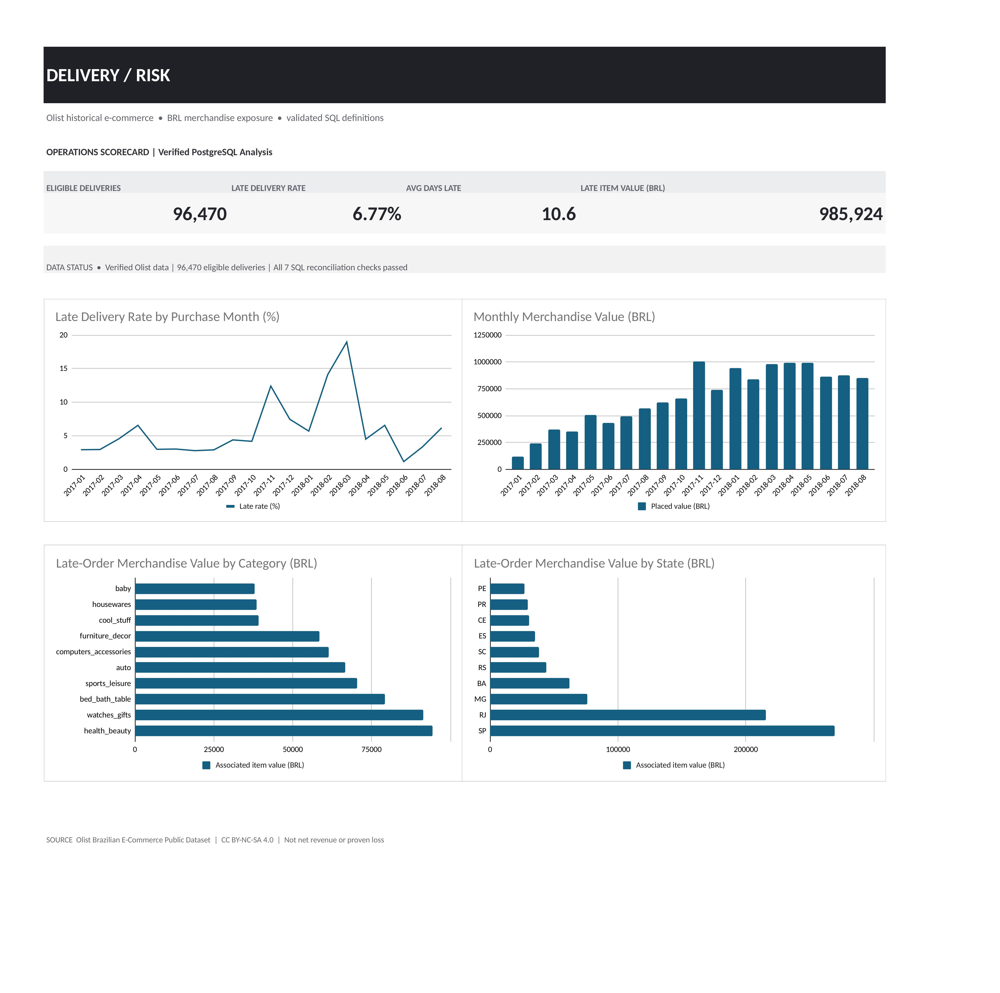

# E-Commerce Delivery Delay Analysis

**PostgreSQL · SQL · Google Sheets / Excel**

**Abstract.** Most delivery reports start with a percentage. I wanted to know what an operations team could actually do with it. I worked through Olist's raw orders, checked where the calculations could go wrong, and used the results to narrow down where to investigate first.



## Key findings

I analysed **99,441 orders** from the [Olist Brazilian E-Commerce dataset](https://www.kaggle.com/datasets/olistbr/brazilian-ecommerce).

| Metric | Result |
|---|---:|
| Eligible delivered orders | 96,470 |
| Late deliveries | 6,534 (**6.77%**) |
| Average days late (late orders only) | 10.62 |
| Merchandise value on late orders | **BRL 985,924** |

**1. Location shows bigger differences than category.** The late rate was **21.41% in Alagoas (AL)** and **17.43% in Maranhão (MA)**, compared with **4.49% in São Paulo (SP)**. **Rio de Janeiro (RJ)** deserves particular attention: **12.11%** of its **12,350 eligible deliveries** were late (1,495 orders). Among the 15 categories with the greatest merchandise value on late orders, rates were much closer together (**5.4–8.1%**). This suggests where to investigate, not what caused the difference.

**2. Two periods stand out.** The late rate rose to **12.40% in November 2017**, then **14.13% in February 2018** and **18.96% in March 2018**. November also saw unusually high order volume. The data does not establish why performance deteriorated.

**3. Reviews get worse as delays get longer.**

| Delivery timing | Avg. review score | 1–2 star reviews |
|---|---:|---:|
| On time | 4.29 / 5 | 9.31% |
| 1–3 days late | 3.29 / 5 | 32.18% |
| 4–7 days late | 2.11 / 5 | 67.68% |
| 8+ days late | 1.70 / 5 | 79.36% |

This is an association, not proof that delays alone caused low scores.

**4. Rate alone can be misleading.** SP had the largest merchandise value associated with late deliveries (**BRL 269,383**), despite its lower late rate. RJ followed with **BRL 215,415**. Looking at rates *and* affected volumes changes the priority list.

**Recommendation:** Start by reviewing delivery routes into RJ and higher-delay states, then examine capacity and fulfilment performance around the November 2017 and February–March 2018 spikes. Use seller-level findings to select cases for investigation, not to assign blame without carrier and operational records.

## How I worked

1. **Import:** Load seven source CSVs into PostgreSQL as text so questionable values remain visible for inspection.
2. **Audit:** Check keys, missing references, dates, prices and duplicate-prone joins. The audit found **8 orders marked delivered without a delivery date** and **610 products without a category**. Reviews also contain repeated records.
3. **Model:** Create views at order, order–seller and order–category level. Aggregate items and reviews before joining so they cannot inflate merchandise value.
4. **Validate:** Reconcile item value across raw items, orders, sellers and categories. **All seven checks passed.**
5. **Analyse and report:** Run 15 business-focused SQL queries, export six summary CSVs and build the dashboard in Google Sheets, saved as `.xlsx`.

**Definitions:** An order is *late* when its actual delivery calendar date is after its estimated date. The late-rate denominator includes only `delivered` orders with valid purchase, actual-delivery and estimated-delivery dates and a sensible chronology. *Merchandise value* is item price in BRL, excluding freight; **it is neither net revenue nor proven financial loss**. Seller/category pair counts are not additive across groups.

## Project files

```text
sql/          Raw import, audit, views, 15 analyses, exports, reconciliation
exports/      Six SQL-generated report CSVs
excel/        Management workbook and refresh guide
assets/       Dashboard image
docs/         SQL walkthrough, methodology and data dictionary
reports/      Case study and management brief
data/raw/     Original Olist CSVs (download separately; not on GitHub)
```

## Run locally (Windows CMD)

Requires **PostgreSQL 16+**. Download the [Olist dataset](https://www.kaggle.com/datasets/olistbr/brazilian-ecommerce) and place the seven CSVs referenced in `sql/02_import_raw.sql` in `data/raw/`. From the project root:

```cmd
set "PGCLIENTENCODING=UTF8"
createdb -h 127.0.0.1 -U postgres ecommerce_delivery
psql -h 127.0.0.1 -U postgres -d ecommerce_delivery -v ON_ERROR_STOP=1 -f sql\01_create_raw.sql
psql -h 127.0.0.1 -U postgres -d ecommerce_delivery -v ON_ERROR_STOP=1 -f sql\02_import_raw.sql
psql -h 127.0.0.1 -U postgres -d ecommerce_delivery -v ON_ERROR_STOP=1 -f sql\03_quality_audit.sql
psql -h 127.0.0.1 -U postgres -d ecommerce_delivery -v ON_ERROR_STOP=1 -f sql\04_build_marts.sql
psql -h 127.0.0.1 -U postgres -d ecommerce_delivery -v ON_ERROR_STOP=1 -f sql\05_report_views.sql
psql -h 127.0.0.1 -U postgres -d ecommerce_delivery -v ON_ERROR_STOP=1 -f sql\08_reconciliation.sql
psql -h 127.0.0.1 -U postgres -d ecommerce_delivery -v ON_ERROR_STOP=1 -f sql\06_analysis.sql
psql -h 127.0.0.1 -U postgres -d ecommerce_delivery -v ON_ERROR_STOP=1 -f sql\07_export.sql
```

Skip `createdb` if the database exists. Use a **dedicated database**: scripts `01` and `04` recreate schemas. Verify every reconciliation result is `PASS` before trusting the exports. See `docs/sql_walkthrough.md` for a code walkthrough.

## Limits and data source

These are **historical 2016–2018 results**, not Olist's current performance. This dataset does not establish the causes of delays or provide enough carrier, refund or cost information to estimate financial losses. Review differences are correlational.

Source: [Olist Brazilian E-Commerce Public Dataset](https://www.kaggle.com/datasets/olistbr/brazilian-ecommerce), **CC BY-NC-SA 4.0**. Independent portfolio project, not affiliated with Olist.